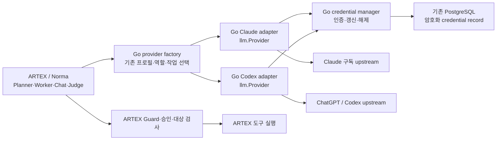

# ARTEX의 Claude·ChatGPT 구독 — Go 네이티브 통합 계획

상태: `feat/native-subscription` 별도 worktree에서 Go 네이티브 통합 구현·자동 검증 완료. 실제 계정 인증·모델 호출은 수행하지 않았다.

## 1. 선택과 범위

사용자는 **외부 CLI 없는 Go 직접 연동**을 우선한다고 선택했다. 이전의 외부 OMP Broker/Gateway 계획을 이 문서로 대체한다.

- OMP의 인증·갱신·모델 전송 동작을 참고하여 ARTEX에 필요한 Go 코드를 구현한다. TypeScript 파일을 실행하거나 Go에서 OMP HTTP gateway를 호출하는 안이 아니다.
- Claude와 ChatGPT/Codex 모두 대상이다. OMP/Bun, Claude Code CLI, Codex CLI, Agent SDK를 인증·추론 런타임으로 추가하지 않는다.
- ARTEX가 자격증명을 소유하고, 새 Go 어댑터가 Norma의 `llm.Provider`를 구현한다. 에이전트·도구 실행·승인·작업 선택은 ARTEX에 남긴다.
- 기본 프로토콜은 조사한 OMP의 `anthropic` 직접 OAuth 및 `openai-codex` 구독 경로다. **공식 ChatGPT SIWC는 이와 다른 인증 계약**이며, 같은 이름으로 섞거나 기존 Codex 토큰을 재사용하지 않는다.
- OMP 전체 에이전트, TUI, 인증 DSL, 모든 공급자, 계정 자동 순환, hosted tools는 이식하지 않는다. 필요한 모델의 검증된 catalog 데이터만 정적 Go 데이터로 관리한다.
- 기존 API Key·Ollama 프로필은 유지한다. 구독 실패를 유료 API나 다른 계정으로 자동 우회하지 않는다.

**승인 범위:** 이번 승인은 외부 CLI 없는 Go 네이티브 설계에 대한 승인이다. 로그인·추론·배포·추가 과금이나 공급자의 이용 허용까지 승인했다는 뜻이 아니다. 특히 Claude 직접 OAuth를 Go로 번역해도 제3자 인증 통합 제한은 달라지지 않는다.

### 근거와 한계

- OMP: `1bdbf6d242d99ca62bdf2feeff4519ff992f647d` 고정 소스.
- ARTEX: 현재 로컬 소스. 이전 분석 시작 시 기록한 기준 커밋은 `278de8b`; 원격과의 동일성은 검증하지 않았다.
- 실제 SDK: `go.mod`의 replace 대상인 `github.com/BaaRai/Norma v0.4.10`.
- 확인: 공급자 소스, Go 인터페이스·호출자, 프로필·암호화·캐시·실패 전환 경로, Compose 선언.
- 미실시: 실제 자격증명 접근, OAuth, 모델 호출, 도구 실행, 테스트·빌드, 청구 확인.

## 2. 목표 구조

팩토리는 기존 프로필당 provider 캐시와 recorder/side-provider wrapping을 유지한다. API Key·Ollama는 기존 Norma built-in provider, 구독은 새 Go provider를 선택한다. 모델 요청 사이에 별도 OpenAI 호환 HTTP 서버를 넣지 않는다.

**소유권**

- `db`: credential 저장·암호화·원자적 갱신·잠금.
- 새 `subscription` Go 패키지: OAuth lifecycle, 공급자별 요청·응답 변환, `llm.Provider` 구현.
- `server`: 공통 manager의 생성·종료, 인증된 관리 API, 프로필·계정 연결, 소비자 연결.
- Norma 내부 포크(`internal/norma`): 기존 중립 메시지·이벤트·실행 경계와 필요한 opaque provider state.

`subscription`은 `agent`나 도구 실행기를 import하지 않는다. 저장은 기존 `db` 경로를 사용하며, 범용 플러그인·인증 DSL·독립 broker를 새로 만들지 않는다.

## 3. 저장 모델과 인증 경계

### 3.1 프로필과 자격증명 분리

기존 작업·역할·대화는 계속 **profile ID**를 참조한다. 각 소비자에 OAuth 필드를 전파하지 않는다.

| 위치 | 추가할 계약 |
|---|---|
| `llm_profiles` | `auth_mode` 기본값 `api_key`, nullable `credential_id`, `auth_binding_generation` |
| `llm_credentials` | ID, 표시 이름, provider kind, lifecycle status, revision/generation, 암호화 payload, 생성·수정 시각 |
| credential payload | provider/auth flow, issuer/client, account/subject/organization 식별, scopes, access/refresh token, expiry와 필요한 공급자 메타데이터 |

- `credential_id`는 `ON DELETE RESTRICT`. 참조 중 credential을 지워 API Key/global fallback으로 넘어가지 않게 한다.
- OAuth 프로필에는 credential reference가 필요하고 API Key는 비운다. 연결 변경과 기존 key 제거를 같은 transaction에서 처리한다.
- `Format`은 기존 `anthropic` / `openai-responses`를 유지할 수 있다. `auth_mode`와 credential의 provider kind로 네이티브 어댑터를 고른다. 잘못된 format/provider 결합은 거부한다.
- 구독 모델명은 공급자의 실제 model ID다. 이전 gateway용 `provider/model` routing prefix를 네이티브 model ID로 그대로 저장하지 않는다.
- profile reference 수정은 기존 관례처럼 생략=유지, `null`=명시적 해제, ID=연결로 구분한다.
- 동일 계정을 여러 모델 프로필이 참조할 수 있다. 다른 account/workspace 로그인은 새 credential identity로 저장한 뒤 사용자가 명시적으로 연결한다.

`agent.Config`에는 비교 가능한 mode/ID/generation만 넣는다. 현재 `server/server.go:464`에서 `Config == Config`를 사용하므로 manager·map·slice·함수를 config에 넣지 않는다. 실제 resolver는 provider 생성 시 주입한다.

### 3.2 기존 암호화 재사용

`db/secrets.go`의 AES-256-GCM·랜덤 nonce·JSONB envelope를 재사용한다. 새 payload column을 `secretColumns`에 등록하여 시작 시 키 검증과 기존 secret inventory에 포함한다. 실제 token을 `api_key`, task credential, transcript에 넣지 않는다.

암호화 AAD는 현재 table/column 단위다. 이것만으로 계정 결속이 검증되지는 않는다. 복호화한 provider·issuer·account·organization이 선택된 credential과 일치하는지 확인한다.

공개 DTO는 credential ID·안전한 표시명·상태·검증 시각만 반환한다. access/refresh/ID token, PKCE verifier, authorization code, 비밀을 포함한 URL은 반환·기록하지 않는다.

### 3.3 ARTEX 로그인과 공급자 로그인은 별개

- ARTEX의 관리자 password/JWT 인증은 그대로 유지한다.
- credential 관리 API는 인증된 `/api/llm/...` 아래에 둔다. `/api/auth/*`는 현재 공통 JWT 검사를 우회하므로 공급자 관리 API를 그 아래에 추가하지 않는다.
- 새 callback listener는 OAuth 시도에만 사용한다. 관리 세션과 결속된 pending attempt의 state·PKCE·만료를 검증하고, credential을 브라우저로 돌려주지 않는다.
- 공급자 인증 실패를 ARTEX 로그인 실패 HTTP 401로 그대로 전달하지 않는다. 현재 frontend는 ARTEX 401에서 로그인 token을 지운다. 공급자 상태는 별도 오류 code/응답으로 표현한다.
- OAuth 교환용 HTTP client는 모델 recording client와 분리한다. token 요청·응답을 connection-test 로그나 raw capture에 넣지 않는다.

## 4. 공통 credential manager

### 4.1 요청과 갱신

1. provider는 profile ID, credential ID, binding generation을 보유한다. token 문자열을 장수 provider에 고정하지 않는다.
2. 각 물리 모델 요청 전에 선택된 binding과 credential 상태를 확인한다. 로그아웃·재연결·만료 상태를 단순한 “없는 프로필”로 축약하지 않는다.
3. refresh는 **credential ID 단위 single-flight**로 합친다. 같은 계정을 공유하는 두 프로필이나 여러 Worker가 동시에 회전 token을 교환하지 않는다.
4. 다른 프로세스의 중복 refresh도 막도록 credential별 PostgreSQL session advisory lock을 전용 connection에서 획득한다. 기존 startup 전역 migration lock과 분리한다.
5. lock 획득 뒤 최신 record를 다시 읽고, 여전히 필요한 경우에만 공급자 교환을 수행한다. HTTP 동안 장기 DB transaction을 열어 두지 않는다.
6. 최신 access/refresh/expiry/identity를 revision 검사와 함께 원자 저장하고 lock을 해제한다. CAS만으로 중복 token 교환을 막을 수 있다고 가정하지 않는다.

공급자별 교환 timeout과 manager shutdown deadline을 둔다. session lock은 같은 PostgreSQL session에서 해제하며, transaction-pooling proxy를 통해 session 소유권이 바뀌는 배포는 지원한다고 가정하지 않는다.

한 요청의 취소는 그 대기자만 종료한다. 이미 공유 refresh가 회전 token을 받는 중이면 저장까지 마치도록 manager 소유 context를 사용한다. 종료 시 새 요청을 막고 refresh/저장을 drain한 후 DB를 닫는다.

공급자의 회전 완료와 로컬 영속화 사이의 crash는 완전히 원자화할 수 없다. 이 경우 재인증 필요를 명시하며, 예전 token이나 다른 계정으로 복구했다고 가장하지 않는다.

### 4.2 재인증·로그아웃

- refresh, 재인증, 해제는 같은 credential 직렬화 규약을 따른다. 오래된 refresh가 새 로그인이나 revoked 상태를 덮지 못하게 한다.
- 로그아웃은 durable 상태를 revoked로 만들고 해당 credential의 새 요청을 차단한다. 캐시 삭제만으로 구현하지 않는다.
- 해당 credential의 진행 중 로컬 요청은 취소한다. 이미 공급자가 처리한 요청의 과금 취소나 원격 즉시 중단까지 보장하지 않는다.
- 검증된 공급자 revocation 기능이 있으면 시도한다. 미지원·네트워크 실패로 원격 폐기가 확인되지 않으면 로컬 token 제거와 그 한계를 구분하여 표시한다.
- 다른 credential의 요청·refresh는 취소하지 않는다.
- 동일 계정의 정상 refresh는 profile/side-context identity를 바꾸지 않는다. 계정·조직 연결 변경은 binding generation과 관련 캐시를 갱신한다.
- 오래된 provider 참조도 다음 요청에서 generation을 확인한다. 캐시 map을 교체했다고 이미 생성된 ChatAgent·Worker 참조가 사라진다고 가정하지 않는다.

기본 Compose는 backend 하나다. DB lock은 credential 교환 경합을 막는 장치이며, 전체 ARTEX의 active-active 운영이나 모든 프로세스의 진행 중 요청 즉시 취소를 보증하는 장치가 아니다.

## 5. 공급자별 Go 이식

### 5.1 Claude: 직접 OAuth + Messages

**참고 소스:** [인증 선언][omp-claude-auth], [공통 OAuth engine][omp-oauth-engine], [refresh][omp-refresh], [Anthropic client][omp-claude-http], [Anthropic adapter][omp-claude-adapter].

- authorization-code + PKCE, pending state 검증, code 교환, 만료 계산, 계정·조직 bootstrap, refresh를 Go로 구현한다.
- 원본의 고정 callback 계약과 로그인 시 확정한 organization identity를 유지한다. refresh가 조직 결속을 임의로 변경하지 않게 한다.
- token 응답에 필요한 계정 정보가 없을 때의 검증된 bootstrap 경로도 포함한다. 짧은 `registry/oauth/anthropic.ts` hook 하나만 번역하지 않는다.
- 요청은 공급자 bearer 방식의 직접 Messages 경로다. 일반 Anthropic API Key adapter에 token만 대입하지 않는다.
- system/content/tool schema·도구 이름의 wire 변환, thinking signature·redacted thinking, cache 사용량, stop reason, 오류를 실제 OMP 경로와 대조한다.
- `Stream`은 공급자 SSE를 정상화한다. `Complete`는 지원되는 실제 non-streaming 응답을 정상화한다. 두 경로가 동일한 도구 ID·메시지·사용량 의미를 갖게 한다.
- wire상 이름을 변환하더라도 ARTEX에는 원래 도구 이름·ID·인자를 반환한다. 변환된 이름을 승인 우회용 별도 도구로 등록하지 않는다.
- 원본의 Claude Code 계열 식별 호환 처리는 공급자 어댑터 내부의 별도 호환 책임으로 기록한다. 이를 ARTEX 공식 인증이나 정책 우회 기능이라고 표시하지 않는다.

**정책 위험:** [Anthropic 공식 조건][claude-legal]은 제3자 앱의 Claude.ai 인증·token 중개를 제한한다. 순수 Go라는 구현 언어는 이 제한을 해소하지 않는다. 개인 기술 검토와 배포 허용은 별개이며, 공급자 허용 여부가 확인되었다고 문서나 UI에 표시하지 않는다.

### 5.2 ChatGPT: Codex 구독 OAuth + Responses

**참고 소스:** [인증 선언][omp-codex-auth], [Codex adapter][omp-codex-adapter], [request transformer][omp-codex-request], [transport][omp-codex-transport].

- OMP의 legacy Codex browser OAuth + PKCE, token 교환·refresh, 계정/workspace 메타데이터 처리를 Go로 구현한다.
- 이 프로토콜의 고정 callback URI와 포트 사용 규칙을 유지한다. 공식 SIWC의 callback 규칙과 혼합하지 않는다.
- 계정 claim을 decode한 것만으로 OIDC 서명 검증을 완료했다고 표시하지 않는다. 선택된 계정/조직과 credential을 결속하고, 권한 판정은 공급자 응답을 따른다.
- 일반 OpenAI API Key 과금과 구분된 Codex Responses 경로를 구현한다. `openai-responses`의 Base URL만 바꾸지 않는다.
- `store:false`, upstream `stream:true`, 전체 필요한 이력, 함수 호출/결과, reasoning과 공급자 고유 replay state를 처리한다.
- 지원하지 않는 sampling/output-cap 필드를 그대로 보내거나, 제거한 뒤 적용됐다고 표시하지 않는다. 모델별 capability와 실제 설정 UI 계약을 맞춘다.
- `response.completed` 이후에만 정상 완료한다. failed/incomplete/중간 오류/EOF/취소는 부분 출력·사용량·원인과 함께 실패로 구분한다.
- **`Complete()`도 내부적으로 upstream SSE를 수집**하여 조립된 응답을 반환한다. frontend가 한 번에 결과를 받는 것과 upstream non-streaming은 다르다.
- 계정 한도·일시 rate limit·인증/동의 실패·네트워크 실패를 구분하고 가능한 code/status/request ID/reset 정보를 보존한다.

ChatGPT 구독 사용도 무제한·무과금을 뜻하지 않는다. 같은 계정의 credits/추가 사용 설정은 라우팅과 별개로 확인한다.

### 5.3 공식 SIWC와의 경계

[공식 SIWC][siwc-signin]는 동적 client 등록, 안정적 host ID, issued client ID, ID-token 검증, plan-use scope 및 [공개 Responses endpoint][siwc-models]를 요구한다. 이 계획의 OMP legacy Codex와 동일한 인증이 아니다.

이번 직접 포팅에는 SIWC를 병행 구현하지 않는다. 공식 경로로 전환하려면 별도 provider kind·credential schema version·검증 계약으로 설계를 교체해야 한다. 기존 Codex token/client ID를 SIWC 값으로 재표기하지 않는다.

## 6. Norma 경계와 메시지 보존

### 6.1 새 네이티브 provider 계약

- 기존 `llm.Provider.Stream` / `Complete`를 구현한다. native 경로에 OpenAI Chat gateway codec을 끼우지 않는다.
- 정상 Stream은 실제 공급자 완료 확인 후 `SEMessageStop`을 한 번만 내보낸다. terminal 오류 뒤 성공 stop을 만들지 않는다.
- JSON이 분할되거나 도구 호출이 교차해 도착해도 호출별 ID·인자가 섞이지 않는다. 인자 JSON·도구 스키마 검증 전에는 도구를 실행하지 않는다.
- Codex `Complete`는 Stream 수집을 이용하고, 실패 시 이미 관측한 usage를 보존하되 부분 응답을 완료로 반환하지 않는다.
- Norma의 현재 “Complete는 반드시 wire stream:false”라는 주석·계약 설명은 provider별 upstream 방식으로 정확히 수정한다. 기존 built-in API provider의 실제 non-streaming 동작은 바꾸지 않는다.
- rate limiter는 공개 `llm.RateLimited`를 재사용한다. 프로필당 하나의 wrapper를 모든 소비자가 공유한다. 새 limiter를 중복 구현하지 않는다.

기존 Norma built-in Chat SSE의 오류 누락, Responses의 stop-event 누락을 새 네이티브 adapter가 그대로 상속할 이유는 없다. **이전 gateway 계획의 두 built-in parser 수정은 네이티브 통합의 필수 선행 작업에서 제외**한다. 별도 API 경로의 버그를 이번 범위에 끼워 넣지 않는다.

### 6.2 Opaque replay state를 명시적으로 표현

현재 Norma `llm.Message`는 Role/Content 중심이며 Codex의 임의 provider payload를 담는 필드가 없다. 기존 Responses adapter도 replay 시 thinking을 버린다. 따라서 “기존 타입 그대로면 모든 reasoning 왕복이 된다”고 가정하지 않는다.

- Norma에 provider/model/auth-scope를 태그한 **직렬화 가능한 opaque provider state**를 추가한다. payload와 순서는 해당 어댑터가 소유한다.
- Stream event와 Accumulator에도 이 상태를 전달하는 명시적 경로를 추가한다. Anthropic signature 또는 사용자-visible text에 Codex payload를 숨겨 넣지 않는다.
- token이나 credential payload는 이 상태에 넣지 않는다. account scope에는 안정적인 비밀 아닌 식별값을 사용한다.
- transcript 저장·재개, recorder, tool-result 다음 턴, NOA/graph compaction에서 상태가 유지되거나 원래 메시지와 함께 제거되는 계약을 검증한다. 필요한 메시지의 state만 고립되게 버리지 않는다.
- 다른 provider/model/account에 원본 opaque 상태를 보내지 않는다. 기존 Anthropic/OpenAI encoder에 새 메타데이터가 unknown wire field로 유출되지 않도록 명시적으로 제외한다.
- 메모리 전용 전역 map을 replay 저장소로 삼지 않는다. 재시작·동시 대화·계정 변경에도 안전해야 한다.

SDK 배포 방식은 사용자가 추가로 승인한 **ARTEX 내부 포크**로 변경한다. `internal/norma`에 v0.4.10 원본 소스·라이선스·기준 커밋을 보존하고 기존 import를 내부 경로로 이관한다. 공개되지 않은 SDK 버전을 참조하거나, 전체 vendor·module cache 편집·배포용 local-path replace를 사용하지 않는다.

## 7. ARTEX 소비자·실패 정책 마이그레이션

| 지점 | 필요한 변경 |
|---|---|
| `agent/provider.go` | Config의 mode/reference, credential resolver 주입, native factory 선택. `NewProvider`·`TestConnection` 변경 시 LSP reference 전체 이관 |
| `db/config.go`, `db/secrets.go`, 번호 migration | profile 조회/저장/pool column, credential CRUD·암호화·원자 갱신 |
| `server/server.go` | active/profile load, cached provider, apply/invalidation, readiness, legacy LLM 설정의 credential reference 보존 |
| `server/server_mgmt.go`, `server/dto.go` | 프로필 연결·상태 DTO, 연결 검사·모델 목록을 같은 native credential 경로로 통일 |
| `server/task_resolution.go`, `server/task_llm.go` | key 유무 검사 대체. 선택된 구독의 인증 실패를 “프로필 없음”으로 바꾸지 않음 |
| `llmpool/pool.go`, `server/llmpool.go` | native 인증·한도·해제·불확실한 호출 결과에서 자동 계정/API 전환 차단 |
| `server/side_questions.go`, `sidequestion/`, `llmrec/` | 안정적 credential/binding identity, 종료 이벤트·사용량·opaque state·기록 범위 |
| `server/manager.go`의 raw-key 소비자 | DeepSeek 검색 등 별도 API-key 사용처에 구독 token을 빌려주지 않음. 기존 API-key 연동만 유지 |
| `server`/manager와 `cmd/artex/main.go` | manager 소유권, callback listener, 진행 호출 취소·refresh drain·DB 종료 순서 |
| `web/src/lib/types.ts`, `web/src/lib/api.ts`, LLM 설정 화면 | 인증 방식·credential 선택, 로그인/재인증/해제·상태, 비밀 없는 오류 표시 |

### 7.1 인증 오류가 과금 전환으로 바뀌지 않게 한다

확인된 기존 동작:

- 빈 APIKey는 `loadProfileConfig`에서 unusable로 판정된다. binding 생성 실패가 global fallback으로 이어질 수 있다.
- `llmpool.shouldFailover`는 401/403/429와 status 없는 오류 등에서도 전환한다.
- task chain은 quota 오류뿐 아니라 비-quota 오류도 연속 실패 후 다음 프로필로 진행한다.

따라서 `AuthRequired`, `Revoked`, `ConsentRequired`, `SubscriptionLimit`, `BindingChanged` 같은 native 오류를 **pool·quota advance·실패 누적 escalation 전에** 처리한다. 선택한 credential을 유지한 채 재로그인·한도 정보를 표시한다. 문자열에 “quota”가 없는 것만으로 안전하다고 보지 않는다.

네이티브 모델 요청이 전송된 뒤 결과가 불확실하거나 실패하면 자동 replay하지 않는다. Codex `Complete`의 내부 스트림이 실패했는데 외부 출력이 없다는 이유로 재요청하면 중복 사용량이 발생할 수 있다. 사용자가 명시적으로 재시도한다. 기존 API Key/Ollama의 retry·pool 정책은 보존한다.

### 7.2 상태·identity·설정

- 프로필의 존재·설정 완료, 인증 준비, 모델 연결 성공, 구독 잔여량은 서로 다른 상태다. token이 저장되었다는 이유로 모두 정상이라고 표시하지 않는다.
- 보조 질문 identity에는 안정적 credential/account/binding을 포함하고 access token·정상 refresh revision은 제외한다.
- 연결 검사·모델 목록도 임의 Base URL로 OAuth token을 보내지 않는다. native 공급자별 허용 endpoint에 결속한다.
- 모델 목록은 고정 OMP catalog에서 검증한 Go 데이터로 제공하고, 실제 계정 권한 검증과 구분하여 표시한다. catalog 등재만으로 사용 가능·잔여량을 보장하지 않는다.
- 미지원 옵션은 저장 전에 capability를 표시하고 충돌을 명시한다. 무시한 output cap/reasoning 설정을 적용했다고 표시하지 않는다.
- tool 없는 연결 검사·보조 질문·압축·심판도 같은 완료/오류 계약을 따른다.

## 8. 구현 순서와 변경 묶음

### 단계 A — 데이터·공통 lifecycle

`db/llm_credentials.go`, migration, `subscription/manager.go`, `subscription/oauth.go`, `subscription/errors.go`를 추가한다. 기존 암호화, credential별 lock, revision, pending authorization, logout/drain을 구현한다. ARTEX 로그인과 분리하고 비밀 없는 DTO 계약을 확정한다.

**통과 조건:** 동시 refresh는 한 번만 교환·영속화하며, 취소·재인증·로그아웃 경합에서 오래된 token이 되살아나지 않는다. 비밀이 API·recording·로그에 남지 않는다.

### 단계 B — 두 Go 어댑터와 Norma 표현

공통 경계를 바탕으로 `subscription/anthropic.go`와 `subscription/codex.go`를 각각 구현한다. 필요한 catalog 데이터는 `subscription/models.go`에 둔다. 공급자 두 묶음은 독립적으로 작업할 수 있으나 이벤트·opaque state 계약은 먼저 고정한다.

`internal/norma`의 메시지/이벤트/Accumulator·encoder 필터를 보강한다. ARTEX 호출자 import를 이관하고 `go.mod`/`go.sum`에서 외부 Norma 의존성을 정리한다. upstream에 변경을 게시했다고 표현하지 않는다.

**통과 조건:** 두 공급자 각각 text, tool 왕복, reasoning/replay, Stream/Complete, 정상·실패·취소가 소비자에게 정확히 전달된다.

### 단계 C — 전체 ARTEX 경로와 관리 기능

팩토리·캐시·readiness·profile 저장·task chain·pool·side question·연결 검사·모델 목록을 이관한다. 새 `server/llm_credentials.go`에서 인증 시작/시도 상태/재인증/해제를 처리한다. 기존 LLM 설정 화면에 계정 연결을 제공하고 raw token 입력을 요구하지 않는다.

**통과 조건:** 주 대화뿐 아니라 planner·worker·reporter·judge·압축·보조 질문에서 같은 선택 계정과 오류 정책을 사용한다. 기존 API/Ollama·프로필 binding·transcript 재개에 회귀가 없다.

### 단계 D — 실패·영속화·동시성 검증

공급자 네트워크에 접속하지 않는 결정적 HTTP/SSE fixture와 격리 DB로 아래 수용 기준을 검증한다. 공급자 원본 계약을 대조하며, 가짜 “Hello” 응답만으로 호환 완료라 하지 않는다.

**통과 조건:** consumer-visible 회귀 테스트와 실제 provider/consumer 경계 검증을 통과한다. 프로젝트 구현 시에는 변경을 모은 뒤 필요한 좁은 검사들을 한 번 수행하고, 발견한 실패를 수정한다.

### 단계 E — 선택적 활성화·배포·운영 문서

기존 배포를 깨지 않는 callback 포트 옵션, 연결 절차, 계정/비용/정책 상태, token 폐기·복구·정상 종료·롤백 문서를 제공한다. 계정 소유자 승인 후 실제 두 공급자 smoke를 각각 수행한다.

**완료 조건:** 외부 OMP/CLI 없이 Claude와 ChatGPT 각각 정상 인증·갱신·모델/도구 왕복과 실패 경로를 입증한다. 한 공급자만 작동하거나 인증/UI가 형식적으로만 존재하는 상태는 완료가 아니다.

## 9. 필수 수용 시나리오

| 시나리오 | 관측할 결과 |
|---|---|
| 같은 credential의 여러 Worker·프로필 동시 만료 | refresh 교환 하나, 최신 token 원자 저장, 다른 credential은 독립 실행 |
| 잘못된 state·만료된 callback·계정/조직 불일치 | credential 활성화·기존 계정 덮어쓰기·모델 호출이 일어나지 않음 |
| refresh 중 취소·로그아웃·재로그인·종료 | waiter 격리, stale write 차단, 필요한 저장 drain, 로그아웃 후 새 요청 차단 |
| Stream/Complete 정상·failed/incomplete·EOF | 정상 stop 한 번, 오류 원인·usage 보존, 불완전 결과의 완료 checkpoint 금지 |
| 분할 JSON·교차/병렬 도구·여러 턴 | 정확한 호출 ID/인자, 중복 실행 없음, 결과 뒤 이어지는 추론 |
| 승인·대상 검사 거부 | ARTEX·공급자 hosted tool 어디에서도 거부 도구를 대신 실행하지 않음 |
| reasoning/opaque state 저장·재시작·압축 | 필요한 상태 보존, 제거 시 일관성, 다른 provider/account로 유출 없음 |
| 인증 해제·권한 거부·한도·연속 오류 | pool/task chain이 다른 계정/API로 자동 진행하지 않음 |
| Codex Complete 내부 스트림 실패 | 부분 응답 성공 처리·숨은 자동 replay·중복 과금 시도 없음 |
| 부가 소비자와 모델 변경 | judge·reporter·NOA/graph·built-in compaction·보조 질문이 동일한 인증·완료 계약 사용 |
| 상태·옵션·사용량 | 인증과 잔여량 구분, 미지원 옵션 오표시 없음, 추정 API 단가를 구독 청구액으로 표시하지 않음 |
| 기존 프로필 | API Key/Ollama, 빈 key 업데이트, proxy masking, binding·task chain·대화 선택 동작 보존 |
| 비밀과 endpoint | token/코드/인증 URL의 capture·로그 유출 없음, 임의 Base URL로 공급자 token 전송 없음 |

새 테스트는 소비자에게 보이는 위 실패를 잡는 데 한정한다. fixture에는 합성 token만 사용하고 고정 운영 callback 포트·실계정·외부 서비스에 의존하지 않는다.

실계정 검증은 소유자 승인 후 무해한 텍스트와 격리된 도구로 수행한다. 대상 시스템 스캔이나 공격은 하지 않는다. 처음에는 Worker 하나, 다음에 동일 credential 병렬 실행으로 확인한다. 이 문서는 그 성공을 관측한 보고서가 아니다.

## 10. Callback·배포·롤백

- OMP의 Claude callback과 legacy Codex callback은 고정 계약이 다르다. 특히 legacy Codex의 `http://localhost:1455/auth/callback`을 SIWC의 `127.0.0.1` 규칙으로 임의 치환하거나, 포트가 바쁘다고 다른 포트로 옮기지 않는다.
- native host는 loopback listener를 사용한다. Docker는 container 내부 listener와 **호스트 loopback에만 publish한 포트**를 구분한다. 내부 `127.0.0.1` bind만으로 Docker publish가 작동한다고 가정하지 않는다.
- 기존 8787/8788 외의 callback 포트는 명시적 opt-in으로 구성하고, 필요할 때만 listener를 연다. 포트 충돌은 명확히 실패시키며 다른 프로세스를 종료하지 않는다.
- 원격 브라우저의 localhost는 ARTEX 호스트가 아니다. 지원하는 로그인은 loopback tunnel 또는 최종 redirect URL의 인증된 수동 제출로 명시한다. 수동 제출도 pending state/PKCE/만료/원래 callback URI를 검증하며 token·URL을 로그에 남기지 않는다.
- endpoint·callback·client 정보는 고정 공급자 계약에서 관리한다. 임의 외부 URL을 주입하여 OAuth credential을 보내는 설정은 만들지 않는다.
- 프로필 기본 활성화는 하지 않는다. 공급자 이용 허용 여부·계정 소유·추가 사용/credits 설정을 확인하고 사용자가 선택한다. 여러 사용자의 요청을 한 사람의 구독에 묵시적으로 모으지 않는다.
- 롤백은 작업/자동 실행 정지 → 새 모델 요청 차단 → refresh 저장 drain → 구독 선택·bindings 정리 → 승인된 기존 프로필의 명시적 선택 순서다. schema/reference를 모르는 예전 binary로 먼저 내려 API/env fallback을 유발하지 않는다.
- credential/key 백업과 재인증 복구 절차를 제공한다. 계정 순환·재로그인 반복으로 한도를 우회하는 운영 절차는 만들지 않는다.
- OMP에서 번역·재사용한 코드와 배포물의 [MIT 고지][omp-license]를 보존한다. 공급자 프로토콜 변경은 고정 source 비교·fixture 갱신·실계정 재검증을 거쳐 반영한다.

## 11. 판단

이 안은 gateway 설정 변경이 아니라 **ARTEX의 일급 구독 인증·전송 기능 개발**이다. 외부 인증/중계 런타임과 중간 프로토콜 변환을 없애는 대신, OAuth 비밀·갱신·두 공급자의 호환성을 ARTEX가 유지한다.

순수 Go 선택은 반영했다. 아직 확인되지 않은 것은 실제 계정에서의 인증·추론 성공, 공급자별 이용 허용, 계정의 모델 권한·추가 과금과 전체 런타임 상호운용성이다. 구현·로그인·테스트 완료로 해석하지 않는다.

## 근거

[omp-claude-auth]: https://github.com/can1357/oh-my-pi/blob/1bdbf6d242d99ca62bdf2feeff4519ff992f647d/packages/catalog/src/compat/rules/auth/anthropic.kdl
[omp-oauth-engine]: https://github.com/can1357/oh-my-pi/blob/1bdbf6d242d99ca62bdf2feeff4519ff992f647d/packages/ai/src/registry/engine/oauth-code.ts
[omp-refresh]: https://github.com/can1357/oh-my-pi/blob/1bdbf6d242d99ca62bdf2feeff4519ff992f647d/packages/ai/src/auth/refresh.ts
[omp-claude-http]: https://github.com/can1357/oh-my-pi/blob/1bdbf6d242d99ca62bdf2feeff4519ff992f647d/packages/ai/src/providers/anthropic-client.ts
[omp-claude-adapter]: https://github.com/can1357/oh-my-pi/blob/1bdbf6d242d99ca62bdf2feeff4519ff992f647d/packages/ai/src/providers/anthropic.ts
[omp-codex-auth]: https://github.com/can1357/oh-my-pi/blob/1bdbf6d242d99ca62bdf2feeff4519ff992f647d/packages/catalog/src/compat/rules/auth/openai-codex.kdl
[omp-codex-adapter]: https://github.com/can1357/oh-my-pi/blob/1bdbf6d242d99ca62bdf2feeff4519ff992f647d/packages/ai/src/providers/openai-codex-responses.ts
[omp-codex-request]: https://github.com/can1357/oh-my-pi/blob/1bdbf6d242d99ca62bdf2feeff4519ff992f647d/packages/ai/src/providers/openai-codex/request-transformer.ts
[omp-codex-transport]: https://github.com/can1357/oh-my-pi/blob/1bdbf6d242d99ca62bdf2feeff4519ff992f647d/packages/ai/src/providers/openai-codex-transport.ts
[omp-license]: https://github.com/can1357/oh-my-pi/blob/1bdbf6d242d99ca62bdf2feeff4519ff992f647d/LICENSE
[claude-legal]: https://code.claude.com/docs/en/legal-and-compliance
[siwc-signin]: https://developers.openai.com/siwc/token-sharing-open-source/sign-in.md
[siwc-models]: https://developers.openai.com/siwc/token-sharing-open-source/models-and-inference.md

추가 로컬 근거:

- `agent/provider.go:34,347–394` — Config와 provider 생성; LSP에서 `NewProvider`의 11개 reference 확인.
- Norma v0.4.10 `llm/provider.go:173–183`, `llm/ratelimit.go:125–160` — 사용자 구현 Provider와 공개 rate wrapper.
- Norma v0.4.10 `llm/types.go:35–88,121–124`, `llm/openai_responses.go:86–123` — 메시지 표현과 기존 replay 제약.
- `db/config.go`, `db/secrets.go:24–94`, `db/schema.sql` — 프로필·암호화·reference의 재사용 경계.
- `server/server.go:459–629`, `server/side_questions.go:43–50` — profile 캐시·key readiness·identity.
- `server/task_llm.go:319–390`, `llmpool/pool.go:231–247` — 실패 전환과 replay 경계.
- `server/auth.go:215–234`, `server/server_mgmt.go`, `server/dto.go` — ARTEX 인증·관리 API 경계.
- `docker-compose.yml:17–66`, `Dockerfile` — 현재 단일 backend 선언과 배포 구조.

## 구현 중 확정한 복구 경계

- SDK의 정상 opaque-only assistant 메시지를 보존한다. 빈 텍스트를 합성하지 않으며, 기존 API wire encoder는 해석할 수 없는 빈 assistant를 전송하지 않는다.
- 구독 요청의 결과를 확인하지 못한 채 작업이 중단되면 자동 재요청하지 않는다. `tasks.native_used`와 `native_recovery_hold`를 별도 저장한다.
- 정상 실행 중 `native_used`만으로 작업을 막지 않는다. 재시작·만료된 claim 복구·terminal native 오류가 hold를 설정한다.
- 보수적으로, 구독을 사용한 미완료 작업은 마지막 요청이 완료됐을 가능성이 있어도 재시작 후 명시적 **Resume**을 요구한다. 사용량 추가 소비를 막기 위한 선택이며, 정상 도구 연속 호출이나 opaque state를 제거하지 않는다.
- 명시적 Resume만 기존 admission CAS와 같은 transaction에서 hold를 해제하고 `native_outcome_unknown`으로 막힌 intent를 다시 연다. 프로필 변경·FIFO·내부 wake-up·timeout 최종 planner는 이를 우회할 수 없다.
- 종료 시 HTTP·작업 최종 저장·native refresh commit을 DB 종료보다 먼저 drain한다. 강제 종료 후에는 저장된 hold로 복구를 차단한다.
- 실제 구독 계정의 인증·모델 권한·정책 적합성은 합성 HTTP fixture 검증과 별개다. 소유자 계정으로 승인된 smoke 전에는 실계정 성공을 주장하지 않는다.

## 검증 결과

- `go test -count=1 -p 1 -timeout=300s ./...` 및 `go vet ./...` 통과.
- 기존 CI의 15개 패키지와 새 `subscription` 패키지의 race 검사 통과. SDK의 LLM·compaction·harness·agentcore 및 변경된 NOA overflow 경계도 race 검사 통과.
- 웹 TypeScript 검사, polling·replay 테스트, `build:static`, `-tags embedui` 실제 바이너리 빌드 통과. LSP workspace 진단과 변경 UI의 impeccable detector에 이슈 없음.
- 합성 PostgreSQL 계정으로 실제 embedded UI의 1440px·390px 동작 확인: 계정별 공급자 구분, native 프로필 저장 후 비활성 유지, 고정 endpoint·미지원 옵션, 로컬 해제·원격 revocation 미확인 고지, 재인증 pending·잘못된 redirect 거부·ARTEX 로그인 유지. 모바일 문서 폭은 390px이며 가로 넘침 없음.
- 픽셀 캡처는 별도 Chromium·직접 CDP·REA screenshot에서도 `Page.captureScreenshot` timeout으로 확보하지 못했다. 위 UI 결과는 실제 DOM·레이아웃 측정·HTTP 응답 관찰이며 스크린샷 시각 검증을 주장하지 않는다.
- Compose override 해석 결과 callback 포트 54545·1455는 host loopback에만 게시되며, container listener는 `0.0.0.0`, 종료 grace는 2분이다. 실제 Docker container 기동은 검증하지 않았다.
- 실제 Claude·ChatGPT 구독 계정 smoke는 소유자 로그인·승인이 없어 미실행이다. 합성 fixture 결과는 공급자 약관 적합성·실계정 entitlement·quota·실제 과금의 증거가 아니다.
